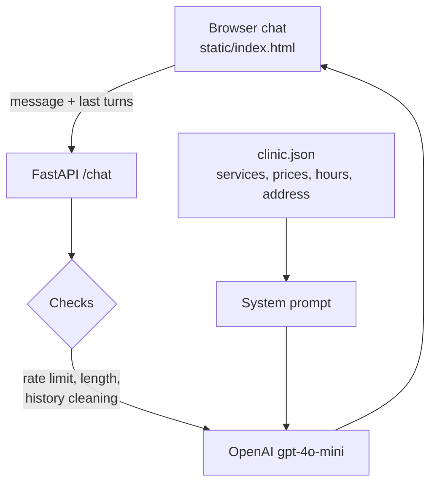

# Clinic AI Chatbot

Turkish customer-service chatbot for dental and aesthetic clinics. Patients ask about services, prices and opening hours in a WhatsApp-style web chat; the bot answers from the clinic's own profile, refuses to give medical diagnoses and sends appointment requests to the clinic's WhatsApp line.

Built with FastAPI and OpenAI `gpt-4o-mini`. The reference clinic, *Gülüş Estetik Kliniği*, is fictional.

## How it works



- **Clinic profile:** services, prices, hours, address and WhatsApp number live in `clinic.json`. The system prompt is built from that file at startup, so a new clinic needs a new JSON file, not code changes.
- **Conversation memory:** the browser keeps the conversation and sends it with each message. The server passes only the last 6 turns to the model.
- **Rules in the prompt:** answer in Turkish, give the price of the service asked about, never invent services or prices that are not in the profile, never diagnose, and point appointment requests to WhatsApp.

## Input handling

The conversation history comes from the browser, so the server does not trust it:

- only `user` and `assistant` turns are kept; a `system` message sent by a client is dropped, so the clinic rules cannot be overridden from the browser,
- messages longer than 1,000 characters are rejected,
- each IP can send 20 messages per minute (`RATE_LIMIT_PER_MINUTE`), which protects the OpenAI budget on a public demo,
- API errors are logged on the server and the patient sees a generic message.

These behaviours are covered by `tests/test_chat.py`, which replaces the OpenAI client with a fake:

```bash
pip install -r requirements-dev.txt
pytest
```

## Run locally

```bash
git clone https://github.com/Taykuth/ClinicChatBotAi.git
cd ClinicChatBotAi
pip install -r requirements.txt
cp .env.example .env        # add your OPENAI_API_KEY
uvicorn main:app --reload   # open http://localhost:8000
```

Optional environment variables: `OPENAI_MODEL` (default `gpt-4o-mini`), `CLINIC_FILE` (default `clinic.json`), `RATE_LIMIT_PER_MINUTE` (default 20).

## Deploy on Render

1. New → Web Service, connect this repository.
2. Build command: `pip install -r requirements.txt`
3. Start command: `uvicorn main:app --host 0.0.0.0 --port $PORT`
4. Add `OPENAI_API_KEY` under Environment.

On the free tier the service sleeps after inactivity, so the first message can take around 30 seconds.

## API

`POST /chat`

```json
{
  "message": "Botoks ne kadar?",
  "history": [
    {"role": "user", "content": "Merhaba"},
    {"role": "assistant", "content": "Merhaba! Size nasıl yardımcı olabilirim?"}
  ]
}
```

Response: `{"reply": "..."}`. Errors use the same shape with status 400 (empty or too long), 429 (rate limit) or 502 (OpenAI error).

## Limitations

- All clinic knowledge is in the prompt. There is no retrieval, so a long price list or FAQ would need a RAG step.
- There is no evaluation set yet. The next step is 50–100 real patient questions with expected answers (price, hours, refusal to diagnose, redirect to WhatsApp) scored automatically.
- The rate limit is in memory: it resets on restart and is not shared between several server processes.
- Messages are sent to OpenAI. Patients may write health details, so a real clinic deployment needs a KVKK review and a privacy notice in the chat.
- There is no human handoff other than the WhatsApp link, and no conversation log for the clinic to review.

## Project structure

```
ClinicChatBotAi/
├── main.py              FastAPI app, prompt building, input checks
├── clinic.json          clinic profile
├── static/index.html    chat UI (single file, no framework)
├── tests/test_chat.py   endpoint tests with a fake OpenAI client
├── requirements.txt
├── requirements-dev.txt
└── Procfile             start command for PaaS hosts
```

MIT License.
